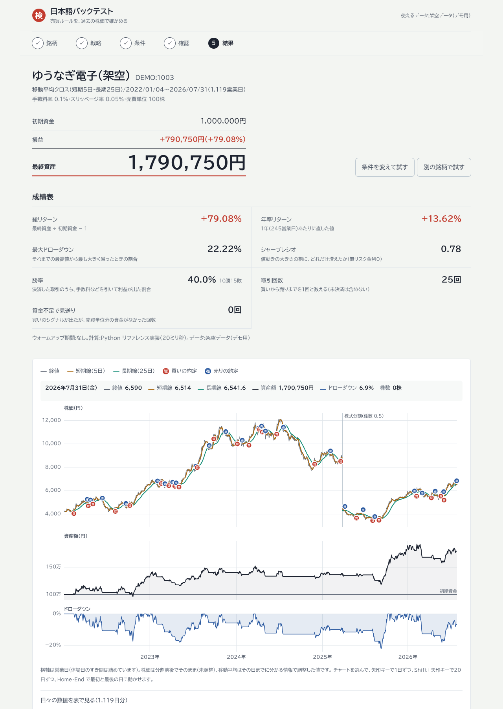
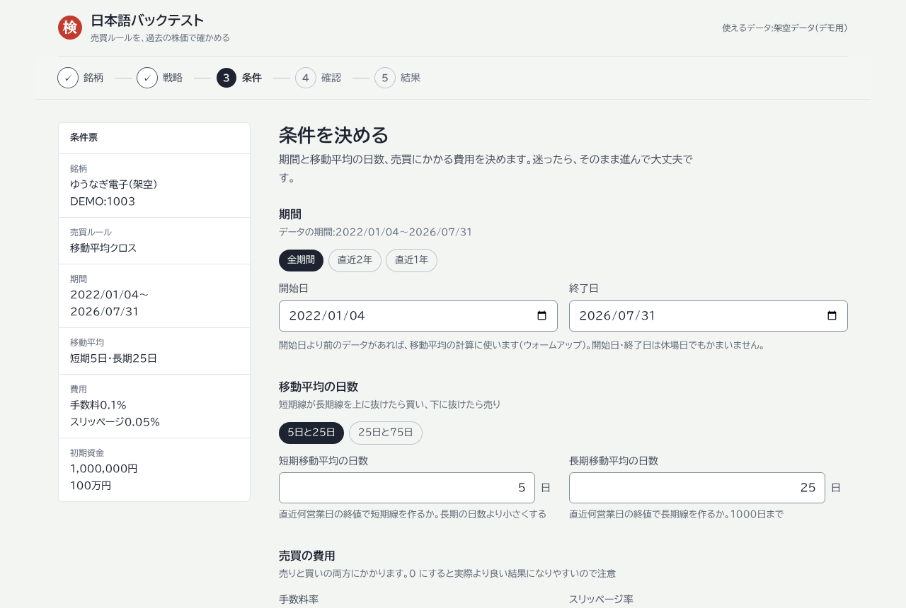
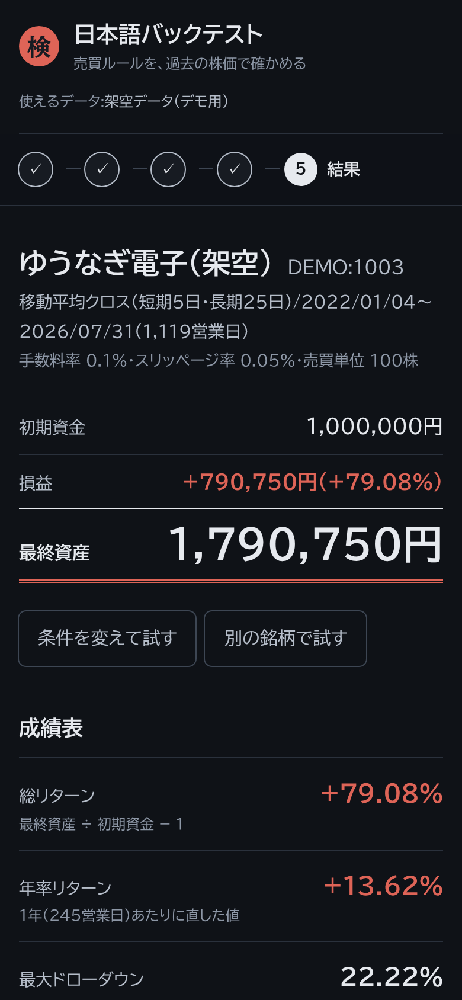
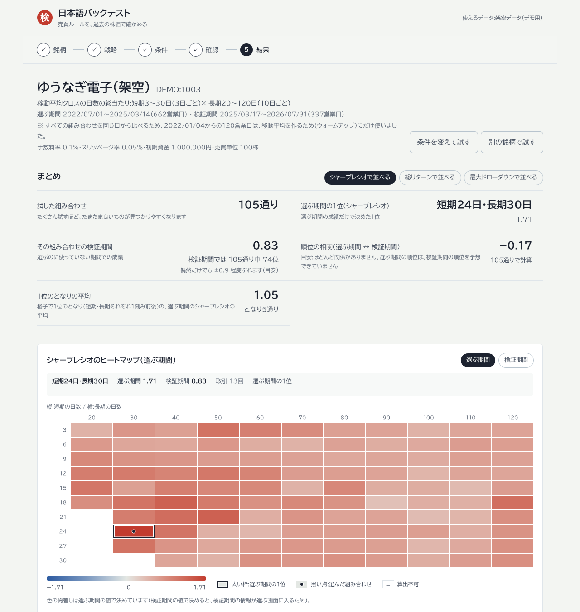
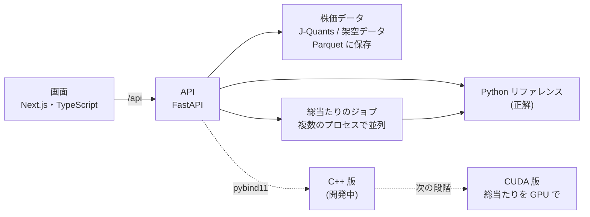

# 日本語バックテスト

[](https://github.com/Linear1002/backtest-app/actions/workflows/ci.yml)

**売買ルールを、過去の株価で確かめる。** 銘柄と売買ルールを選ぶと、手数料・スリッページ込みで「この期間にこう売買していたらどうなったか」を日本語の画面で見られる Web アプリ。



<p>
  
  
</p>

> 画面の銘柄・株価はすべて架空データ(DEMO)。実在の銘柄・株価ではない。

## 何ができるか

- **5つの手順**:銘柄を選ぶ → 売買ルール → 条件(期間・移動平均の日数・手数料・スリッページ・初期資金)→ 確認 → 結果
- **結果**:最終資産・損益、成績表(総リターン・年率・最大ドローダウン・シャープレシオ・勝率)、株価と移動平均・資産額・ドローダウンのチャート、取引の記録、分割・併合の処理、結果を読むときの注意
- **パラメータの総当たり**:移動平均の日数の組み合わせ(既定 105通り、最大 2,000通り)をまとめて試し、ヒートマップと順位で比べる。
  期間の最後を「検証期間」として取っておき、選ぶのに使っていない期間の成績も並べる(過剰最適化への備え。`docs/sweep.md`)。
  気になるマスを選ぶと、その組み合わせの売買の記録まで見られる
- **データ**:J-Quants API(東証。APIキーが必要)と、APIキーなしで動く架空データ12銘柄
- いまの売買ルールは移動平均クロス(MVP)。ほかのルールは今後追加する



## こだわったところ:結果が正しいこと

バックテストは「それらしい間違った数字」を出しやすい。だから、見た目より先に正しさの仕組みを作った。

1. **先読みバイアスを仕組みで防ぐ**
   当日の終値でシグナルを判定し、次に売買が成立した日の始値で約定する。移動平均は「その日までに分かる情報だけ」で株式分割を調整した終値で計算する(データ提供元の調整済み株価は、後の分割で過去の値が書き換わるので使わない)。株数・資金の判定には未調整の株価を使う
2. **仕様書を先に書く**:`docs/mvp.md` に計算の決まりを、足し算の順番・丸め方・エラーの判定順まで書いた。実装とテストは仕様の節番号で対応している
3. **3段階の「正解」**:Python のリファレンス実装(遅くてよい・読んで正しいと分かる)→ C++ 版 → CUDA 版の順に、それぞれが前の段と一致することをテストで確かめる
4. **正解データ60ケース**(`tests/golden/`):同値をはさんだクロス、資金不足、売買不成立の日の権利落ち、端数の出る併合、損益が +ε で計算の順番を変えると勝ち負けが入れ替わる取引、データの異常 など。日付・株数・勝ち負けは完全一致、金額は相対誤差 1e-9 以内で比べる
5. **数字を正直に見せる**:手数料の既定値を0にしない、期間末の評価は「清算コスト控除前」と書く、生存者バイアスの注意を出す
6. **たくさん試したときの「たまたま」を隠さない**:総当たりの1位は、偶然うまくいっただけの組み合わせであることが多い(データスヌーピング)。
   順位は「選ぶ期間」だけで付け、試した数・その1位の検証期間での順位・2つの期間の順位相関を結果のいちばん上に出す
   (架空データ DEMO:1003 の既定の条件では、選ぶ期間の1位が検証期間では 105通り中 74位、順位相関は −0.17 だった)。
   長期の日数が違う組み合わせも同じ日から評価し、色の物差しにも検証期間の値を混ぜない
7. **独立した検証役**:実装とは別に、仕様との食い違いを探す役(検証部)とコードレビュー役を置き、見つかった問題を直した(例:調整済み株価で株数を決めると、将来の分割の情報で「買えなかったはずの取引」が成立してしまう問題)

## しくみ



| 部分 | 技術 |
|---|---|
| 画面 | Next.js(App Router)・React・TypeScript・Tailwind CSS。チャートとヒートマップは自前で描く |
| API | Python・FastAPI・pydantic。総当たりはジョブ(途中経過の問い合わせ・中止)にして、複数のプロセスで並列に計算する |
| データ | J-Quants API V2(回数の上限・429 の待ち・ページ送りに対応)、Parquet(pyarrow) |
| 計算エンジン | Python(リファレンス)、C++17(CPU 版)、CUDA(GPU 版。計画中)、pybind11 |
| テスト | pytest、GoogleTest、node:test、Playwright(画面〜API の通し + axe によるアクセシビリティの自動チェック) |
| CI | GitHub Actions(Python・C++・画面・通しのテストを、push と PR のたびに) |

## 動かし方

前提:Linux または WSL2(Ubuntu)に build-essential・cmake 3.28 以上・ninja-build・[uv](https://docs.astral.sh/uv/)・Node.js(`.nvmrc` の版)

```bash
make setup        # 依存のインストールと C++ のビルド設定
make dev-api      # API → http://localhost:8000/docs(API の説明とお試し実行)
make dev-web      # 画面 → http://localhost:3000(別のターミナルで)
```

架空データ(DEMO)はそのまま使える。東証の銘柄を使うときは、`.env.example` を `.env` にコピーして J-Quants の APIキーを書く(`docs/data.md`)。

```bash
make test         # C++ のビルド・pytest・GoogleTest・画面の関数のテスト
make lint         # ruff・ESLint
make e2e          # 画面〜API の通しのテスト(Playwright)
```

`make e2e` を初めて動かす前に、Playwright のブラウザを入れておく:`cd frontend && npx playwright install --with-deps chromium`

## いまの状態

| 段階 | 状態 |
|---|---|
| 仕様書(`docs/mvp.md`) | できた |
| 株価データ・Python リファレンス・API・画面 | できた |
| パラメータの総当たり(仕様 `docs/sweep.md`・Python 版・正解データ14ケース・API・画面) | できた(計算は Python を複数のプロセスで) |
| C++ 版エンジン | **作者が自分で書いている**(手順:`docs/cpp/README.md`。正解データとの答え合わせは CI で自動) |
| C++ 版・GPU 版の総当たり | 計画(`docs/gpu-plan.md`。正解データと、API に差し込む場所は用意してある) |

## ドキュメント

| ファイル | 中身 |
|---|---|
| `docs/mvp.md` | MVP の仕様(計算の決まりの正) |
| `docs/sweep.md` | パラメータの総当たりの仕様(格子・選ぶ期間と検証期間・並べ方・API) |
| `docs/tour.md` | コードの読み方ガイド(1回のバックテストがどのファイルを通るか) |
| `docs/data.md` | 株価データの取得・保存と、利用規約 |
| `docs/cpp/README.md`・`docs/cpp/contract.md` | C++ 版を書く道のり(マイルストーン M0〜M8)と入出力の約束 |
| `docs/gpu-plan.md` | GPU 版の計画 |
| `docs/roadmap.md` | 全体の進め方 |
| `docs/interview.md` | このプロジェクトを説明するためのメモ |
| `frontend/README.md`・`frontend/DESIGN.md` | 画面の構成と、デザインの決まり |

## AI(Claude Code)との分担

画面・API・データ層・Python リファレンス実装・テストの仕組みは Claude Code が書き、作者が計画を承認・レビューした。
計算の中心である **C++ 版・CUDA 版は作者が自分で書く**(`CLAUDE.md` の役割分担)。AI の出力をそのまま信じず、独立した検証役と正解データで確かめる仕組みにしている。

## データの利用について

J-Quants API の無料プランのデータは私的使用に限られる。取得したデータはリポジトリに入れず、公開する画面やスクリーンショットには架空データだけを使っている。

---

## English summary

A Japanese-language web app for backtesting trading rules on Japanese equities, built as a portfolio project with an emphasis on **correctness over appearance**.

- **Look-ahead-free by construction**: signals are evaluated on the close and filled at the next tradable open; moving averages use *point-in-time* split adjustment (only factors known at time *t*), and position sizing uses unadjusted prices.
- **Spec-first**: `docs/mvp.md` specifies every rule down to summation order, rounding and error precedence.
- **Three-tier correctness**: a slow, readable Python reference engine is the oracle; the C++ engine (being written by the author) must match it on 60 golden cases (exact for dates, share counts and win/loss; 1e-9 relative tolerance for amounts — or bit-for-bit in strict mode), and a future CUDA parameter sweep must match the C++ engine.
- **Parameter sweep with an honest holdout**: grid search over moving-average windows (up to 2,000 pairs in Python, run as a cancellable background job across processes), ranked on an in-sample period only and re-tested on a held-out period. The UI leads with the number of trials, the in-sample winner's out-of-sample rank and the Spearman rank correlation between the two periods, so a lucky winner is visible as such (`docs/sweep.md`, 14 golden sweep cases).
- **Stack**: Next.js/TypeScript (hand-drawn SVG charts and an ARIA-grid heatmap), FastAPI, J-Quants API with rate limiting and Parquet caching, pytest/GoogleTest/node:test/Playwright with automated WCAG checks, GitHub Actions CI.
- **AI collaboration, stated honestly**: the UI, API, data layer and reference engine were written with Claude Code under the author's review; the C++/CUDA engines are the author's own work.
