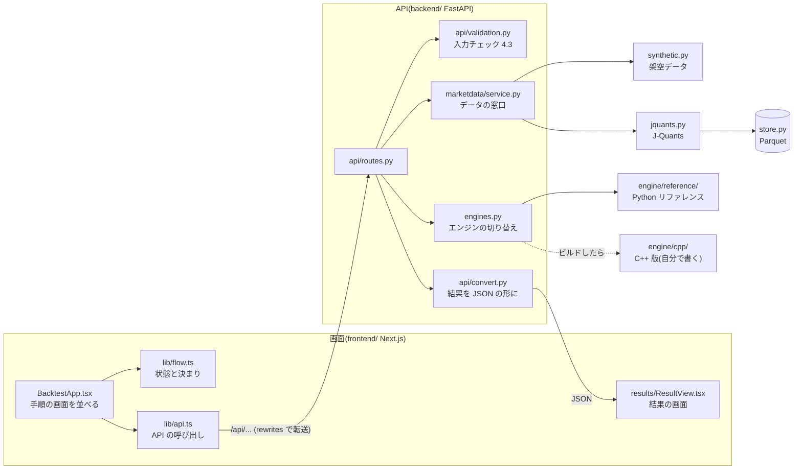
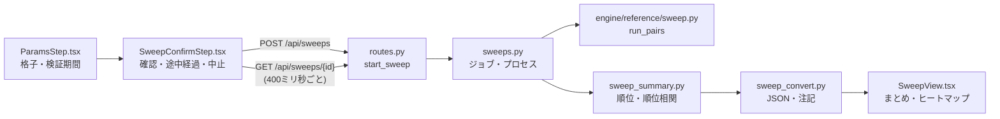

# コードの読み方ガイド

このリポジトリを初めて読む人(未来の自分を含む)のための地図。
1回のバックテストが「画面のボタン → API → 計算エンジン → 画面の結果」と、どのファイルのどの関数を通るかを順に追う。
面接で「全体の流れを説明してください」と言われたときの下書きにもなる(`docs/interview.md`)。

- 計算の決まりごとの正:`docs/mvp.md`(このガイドでは「仕様 2.6」のように節番号で書く)
- C++ 版を自分で書く道のり:`docs/cpp/README.md`
- どの順に読んで、何を確かめるか(問いと答えつき):`docs/study.md`

## 0. 全体の地図

## 1. 画面(`frontend/`)

| ファイル | 役割 | 読むときのポイント |
|---|---|---|
| `app/page.tsx` → `components/BacktestApp.tsx` | 画面の骨組み。ヘッダー・手順の表示・条件票・各手順の画面を並べ、API を呼ぶ | 状態は自分では持たず、`useReducer(flowReducer)` に任せている |
| `lib/flow.ts` | **手順の状態と、その移り変わり**(reducer) | いちばん大事な決まりはここ:古い応答を捨てる(番号)、結果は同じ条件のときだけ見られる、実行中は何も変えられない |
| `components/steps/` | 手順1〜4の画面(銘柄・戦略・条件・確認) | 画面は「見せる」と「ボタンが押されたことを伝える」だけ。判断は flow.ts |
| `lib/form.ts` | 入力欄の文字 → 数値、入力チェック | 範囲は API が返す ParamSpec から読む。メッセージは API と同じ文(仕様 4.3)。同じ表で両方を確かめている(6章) |
| `lib/api.ts` | `fetch` のラッパーと、API の型 | 失敗はすべて日本語の `ApiError` にする。「API が起動していない」と「API の中のエラー」を見分ける |
| `components/results/ResultView.tsx` | 結果の画面(計算書・成績表・取引の記録・注記) | 数字の見せ方の決まりは `DESIGN.md` |
| `components/results/TimeSeriesCharts.tsx` + `lib/chart.ts` | 株価・資産額・ドローダウンのチャート(SVG を自前で描く) | 目盛りは `niceScale`、数字の桁は `axisLabels`(`lib/format.ts`) |

**1回のバックテストで画面の中で起きること**

1. 「バックテストを実行」→ `BacktestApp.tsx` の `run()`
2. `currentRequest(state)`(flow.ts)で、いまの条件からリクエストを作る
3. `dispatch({ type: "runStarted", id, request })` → 実行中になる(手順の移動・条件の変更を受け付けなくなる)
4. `api.runBacktest(request)`(api.ts)→ `POST /api/backtests`
5. 成功:`runSucceeded` → 結果を `last` に記録して手順5へ。失敗:`runFailed` → 入力の誤りなら手順3のその欄へ、それ以外は確認の画面に文で出す

## 2. 中継(`frontend/next.config.ts`)

画面からの `/api/...` は、Next.js の rewrites で FastAPI(既定 `http://localhost:8000`)に転送する。
画面と API が同じオリジンに見えるので、CORS の設定がいらない。待ち時間の上限は `experimental.proxyTimeout`。

## 3. API(`backend/`)

| ファイル | 役割 |
|---|---|
| `main.py` | `create_app()`:アプリを作る。`uvicorn --factory` で呼ぶので、import しただけでは .env を読まない |
| `api/routes.py` | エンドポイント:`/api/meta`・`/api/symbols`・`/api/symbols/{symbol_id}`・`/api/strategies`・`/api/backtests` |
| `api/validation.py` | 入力チェック(仕様 4.3)。`check_param` が ParamSpec(種類・範囲)から判定する |
| `api/errors.py` | 例外 → 日本語の JSON(`{"detail": ..., "errors": [...]}`)。想定外の例外も必ず JSON にし、中身はログにだけ出す |
| `api/convert.py` | エンジンの結果 → 画面に返す形。注記(清算コスト控除前・生存者バイアスなど)もここで作る |
| `engines.py` | 計算エンジンの切り替え(Python リファレンス / C++ 版)。C++ 版がビルドされていれば自動で選べるようになる |
| `strategies.py` | 戦略の一覧と、パラメータの既定値・範囲・説明(ParamSpec。画面の入力欄もこれから作る) |

**`POST /api/backtests` の中(`run_backtest_endpoint`)**

1. 戦略が使えるか → 銘柄IDを読む(`SymbolId.parse`。市場ごとの設定もここで決まる)→ パラメータのチェック(`validate_params`。% → 割合に直す)→ エンジンを選ぶ(`get_engine`)
2. 銘柄が対象か(`require_listed`。現在上場の銘柄だけ:仕様 3.6)→ 日足を読む(`service.load`)
3. 期間のチェック(`validate_period`。データの範囲のチェックはここだけで行う)
4. **銘柄の全期間の日足**をエンジンに渡す(`convert.to_engine_bars` → `run(...)`)。読み込む範囲の切り出しはエンジンの仕事
5. 比較の基準として、同じ期間・同じ費用の**買い持ち**を計算する(`engine/reference/benchmark.py` の `run_buy_and_hold`。エンジンにかかわらず Python で。`docs/benchmark.md`)
6. 結果を `convert.*_out` で JSON の形にして返す(計算にかかった時間も測る)

## 4. 株価データ(`backend/marketdata/`)

| ファイル | 役割 |
|---|---|
| `source.py` | データソースの約束(`DataSource` の Protocol):銘柄一覧・日足・データの範囲 |
| `synthetic.py` | 架空データ(DEMO)。12銘柄に、分割・併合・増資・売買停止・途中上場などの境界ケースを仕込んである。APIキーなしで動く |
| `jquants.py` | J-Quants API V2 のクライアント。1分間の回数の上限(`RateLimiter`)、429 のときの待ち、ページ送り |
| `store.py` | Parquet への保存と読み込み(書き込みは一時ファイル → 置き換えで、途中で壊れないようにする) |
| `service.py` | API から見た窓口。銘柄IDからデータソースを選び、保存が古ければ取り直す |
| `models.py` | 銘柄ID(`TSE:7203` のような「市場:コード」)、日足、市場ごとの設定(売買単位・年間の営業日数など) |

利用規約(私的使用のみ)のため、取得したデータは `data/` に置き、Git には入れない(`docs/data.md`)。

## 5. 計算エンジン(`engine/reference/`)

Python で書いた「正解」。遅くてよいので、仕様の文と1対1で読めるように書いてある。C++ 版はこれと一致させる。

| ファイル | 中身 | 仕様 |
|---|---|---|
| `backtest.py` の `run_backtest` | 全体の流れ(下の表) | 2章・5章 |
| `indicators.py` | 時点 t 基準の調整(CumAdj)、移動平均の和、D(t)、クロスの判定 | 2.2・2.3 |
| `ratio.py` | 調整係数 → 分数 p/q(`floor(x + 0.5)` で丸める) | 2.8 |
| `metrics.py` | 総リターン・年率・最大ドローダウン・シャープレシオ・勝率 | 5章 |
| `types.py` | 日足・パラメータ・結果の型 | − |
| `contract.py`・`csvio.py`・`compare.py`・`cli.py` | C++ 版との答え合わせ(ファイルの形・比べ方・コマンド) | 6章・`docs/cpp/contract.md` |
| `benchmark.py` の `run_buy_and_hold` | 比較の基準:買い持ち。約定・株数・分割・評価・指標は `run_backtest` と同じ関数を呼ぶ(シグナルの判定だけがない) | `docs/benchmark.md` |
| `sweep.py`・`sweep_files.py`・`sweep_cli.py` | 総当たり(9章) | `docs/sweep.md` |

**`run_backtest` の流れ**

| 順番 | 関数・処理 | 仕様 |
|---|---|---|
| 1 | `validate_params`(パラメータ)→ 開始日 ≤ 終了日 → `validate_order`(日付の順番。入力全体) | 4.3・3.7 |
| 2 | `select_load_range`:開始日より前の有効日を `long_window` 個まで + 期間。期間の営業日が3日未満ならエラー | 2.2・4.3 |
| 3 | `validate_records`:読み込む範囲のレコードだけをチェック | 3.7 |
| 4 | `compute_cross_states`:有効日ごとに D(t) を計算 | 2.2・2.3 |
| 5 | 期間の営業日ごとに:**分割・併合(`apply_split_or_merger`)→ 約定(`fill_buy`・売り)→ 評価 → シグナル**の順。前の2つの関数は買い持ちも使う | 2.5 |
| 6 | `compute_metrics`、ウォームアップの情報 | 5章・4.1 |

## 6. テスト

| 場所 | 何を確かめるか | 動かし方 |
|---|---|---|
| `tests/python/test_reference_*.py` | エンジンの手計算のケース、性質のテスト(未来のデータを書き換えても過去のシグナルが変わらない、買い持ちは「1回だけ買って持ち続けた移動平均クロス」と資産額が完全に一致する、など) | `uv run pytest` |
| `tests/python/test_api.py` ほか | API・入力チェック・データ層・設定 | 同上 |
| `tests/fixtures/` + `test_param_contract.py` | 画面と API で共有する表:パラメータの定義(`ma_cross_params.json`)と、入力 → メッセージ(`param_messages.json`・`period_messages.json`・`sweep_messages.json`)。画面のテスト(`lib/form.test.ts`・`lib/sweep.test.ts`)も同じ表を読むので、片方だけ変えるとどちらかが落ちる | 同上 |
| `tests/golden/` + `test_golden.py` | 正解データ(60ケース)。リファレンスがビット単位で再現すること(`make test` の pytest で動く)、C++ 版があれば一致すること(`make test-cpp`) | `make test`・`make test-cpp` |
| `tests/golden/sweeps/` + `test_golden_sweep.py` | 総当たりの正解データ(24ケース。9章) | 同上 |
| `tests/cpp/` | C++ のビルド確認(C++ 版のテストは `engine/cpp/tests/` に自分で書く) | `ctest --test-dir build` |
| `frontend/lib/*.test.ts` | 画面の状態遷移・入力チェック・目盛り・表示 | `npm --prefix frontend test` |
| `frontend/e2e/` | 画面〜API〜エンジンを通しで(架空データ)。各手順でアクセシビリティの自動チェック | `make e2e` |
| `.github/workflows/ci.yml` | 上の全部を、push と PR のたびに GitHub で | 自動 |

## 7. おすすめの読む順番

1. `docs/mvp.md` の 2章(戦略)と 5章(指標)を読む
2. `engine/reference/indicators.py` → `backtest.py` の `run_backtest`(仕様の節番号を見ながら)
3. `tests/golden/cases/h01_round_trip/` の入力と正解を開き、手で1日ずつ追ってみる
4. `backend/api/routes.py` の `run_backtest_endpoint` → `api/convert.py`
5. `frontend/lib/flow.ts` と `flow.test.ts`(テストの名前を読むだけで、画面の決まりが分かる)
6. `frontend/components/results/ResultView.tsx`(API の結果がどう画面になるか)

## 8. 手を動かして確かめる

- `make dev-api` → http://localhost:8000/docs で `POST /api/backtests` を「Try it out」。`DEMO:1003` の結果の `events` に分割の処理が出る
- `make dev-web` → 画面で `DEMO:1004`(1:3分割)を全期間で実行し、取引の記録の「100株 → 300株」を見つける。なぜ売値が買値より安いのに利益なのかを説明してみる
- `frontend/lib/flow.test.ts` を1つ読み、似たテストを1つ足してみる(`npm --prefix frontend test`)
- `uv run python -m engine.reference.cli tests/golden/cases/h01_round_trip/input /tmp/out` を動かして、`uv run python -m engine.reference.compare tests/golden/cases/h01_round_trip/expected /tmp/out` で正解と比べる

## 9. 総当たり(パラメータの探索)の流れ

仕様は `docs/sweep.md`(このガイドでは「総当たり 3章」のように書く)。1つ1つの組み合わせの計算は、1回のバックテストとまったく同じ。
違うのは「組み合わせが多い」「時間がかかる」「1位を正直に見せる」の3つで、それぞれ次のファイルが受け持つ。

| ファイル | 役割 | 読むときのポイント |
|---|---|---|
| `engine/reference/sweep.py` | **総当たりの正解**。格子(`validate_grid`)、期間の分け方(`split_segments`)、選ぶ期間の始まりをそろえる(`in_sample_start`・`align_in_sample`)、チェックの順番(`validate_sweep`)、組み合わせを順番に `run_backtest` する(`run_pairs`) | 長期の日数が違っても同じ日から評価するように、選ぶ期間の始まりをいちばん長い長期日数のウォームアップがそろう日にそろえる。検証期間は持ち越しなしで最初から計算し、ウォームアップには選ぶ期間の株価を使う(その日までに分かる値なので先読みではない。総当たり 3章) |
| `backend/sweeps.py` | ジョブ。組み合わせを小分け(最大10通り)にして `ProcessPoolExecutor` に配り、終わった分から数える。中止・同時に2つまで・問い合わせが60秒来なければ打ち切る・終わって30分で消す | 計算はプロセス、見張りはスレッド、リクエストは別のスレッド。共有する値は `job.lock` の中でだけ読み書きする |
| `backend/sweep_summary.py` | 並べ方(選ぶ期間だけで順位を付ける)・検証期間での順位・スピアマンの順位相関・1位のとなりの平均 | 検証期間の値は**順位付けに使わない**。並べ替えに使えるのは選ぶ期間の値だけ(総当たり 7章) |
| `backend/api/sweep_convert.py` | 結果 → JSON。注記(試した数・選んだことによる偏り・清算コスト控除前・生存者バイアスなど) | 「何通り試したか」を必ず書く(総当たり 8章) |
| `backend/api/validation.py` の `validate_sweep_inputs`・`validate_holdout` | 格子・検証期間の入力チェック。画面の `lib/sweep.ts` と同じ文を返す(`tests/fixtures/sweep_messages.json`) | |
| `frontend/lib/sweep.ts` | 組み合わせの数、検証期間の開始日の決め方(最後の3割など)、ヒートマップの色(物差しは選ぶ期間の値だけ)、順位相関の読み方の目安 | 画面に依存しない関数だけ。`sweep.test.ts` で確かめる |
| `frontend/lib/sweepJob.ts` | ジョブを始めて、終わるまで途中経過を問い合わせる。失敗したら待つ時間を倍にしてやり直し、だめならジョブの中止を頼む | API を差し替えて、失敗・中止・画面を閉じたときの流れを `sweepJob.test.ts` で確かめる |
| `frontend/lib/flow.ts` | 1組のバックテストと同じ reducer に、総当たりの状態(実行中・途中経過・中止・結果・結果の画面の見方)を足した | 1組と総当たりの結果は別々に覚える。「詳しく見る」(`inspectCombo`)は、その期間だけの1組の条件にし、出どころを記録する(その条件で実行した結果にだけ「総当たりの中から選んだ」と書く)。「総当たりの結果に戻る」で、総当たりを実行したときの条件に戻す |
| `frontend/components/sweep/` | `SweepView.tsx`(まとめ・上位の表・選んだマスの成績・注記)と `Heatmap.tsx`(ARIA の grid。矢印キーで動き、Enter で選ぶ) | 色だけに頼らない:選んだマスの値は読み取り欄に文字で出し、全部の値は「表で見る」で読める |

**総当たり1回で起きること**

1. 画面:「総当たりを実行」→ `BacktestApp.tsx` の `runSweep()` → `lib/sweepJob.ts` の `runSweepJob()` → `POST /api/sweeps`(すぐに `202` とジョブの番号が返る)
2. API:入力チェック(格子 → 費用 → 期間 → 検証期間)→ 日足を読む → `validate_sweep`(選ぶ期間の始まりをそろえ、データの異常は、いちばん長い長期日数の読み込む範囲で一度だけ確かめる。総当たり 5章)→ ジョブを始める
3. ジョブ:組み合わせを小分けにしてプロセスに配る。各プロセスは `run_pairs` で、組み合わせごとに選ぶ期間・検証期間を `run_backtest` する
4. 画面:400ミリ秒ごとに `GET /api/sweeps/{id}` で途中経過(何通り終わったか)を受け取り、進み具合のバーに出す。「中止する」は `DELETE`
5. 全部終わったら、`sweep_summary.rank` が並べ方ごとの順位とまとめを作り、`sweep_convert.result_out` が JSON にする → 画面は手順5でまとめ・ヒートマップを出す

**手を動かして確かめる**

- `make dev-api` → http://localhost:8000/docs で `POST /api/sweeps` を実行し、返ってきた `id` で `GET /api/sweeps/{id}` を何回か呼ぶ(`done` が増えていく)
- 画面で `DEMO:1003` を「総当たりで比べる」で実行し、選ぶ期間の1位が検証期間で何位だったかを見る。検証期間の開始日を変えると、1位や順位相関はどう変わるか
- `uv run python -m engine.reference.sweep_cli tests/golden/sweeps/s02_demo1003_holdout/input /tmp/sweep-out` で正解データと同じ計算を動かし、
  `uv run python -m engine.reference.sweep_cli tests/golden/sweeps/s02_demo1003_holdout/expected /tmp/sweep-out --compare` で正解と比べる(C++ 版の総当たりもこの形で答え合わせする。総当たり 11章)
